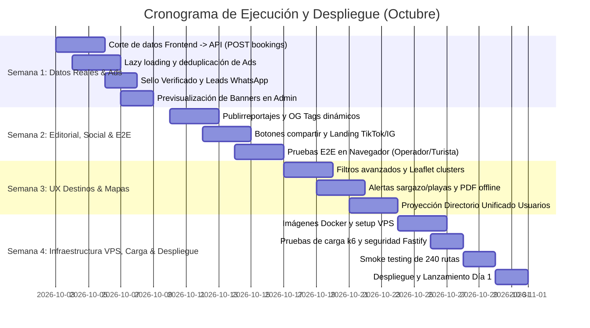

# 🇩🇴 Plan de Acción Maestro: Mejoras Prioritarias para Producción (Octubre)
## Ecosistema Descubre República Dominicana

---

## 🎯 1. Visión y Objetivos de Lanzamiento (Día 1)

El objetivo central de este plan de acción es consolidar el ecosistema digital de **Descubre República Dominicana**, asegurando un **lanzamiento impecable para el Día 1** con foco en:
1. **Monetización Activa:** Ad Server propio (32 formatos), suscripciones B2B para operadores y hoteles con facturación NCF, y publirreportajes.
2. **Corte de Datos Real (Frontend ↔ API):** Desconexión gradual del mock en memoria hacia la base de datos autoritativa en Fastify 5 + PostgreSQL 16.
3. **Conversión y Tráfico desde Redes Sociales:** Captación desde Instagram/TikTok, prueba social, leads directos a WhatsApp y viralidad.
4. **Excelencia UX/UI:** Micro-animaciones, diseño responsive sin fatiga visual, accesibilidad WCAG AA y rendimiento óptimo en móviles.
5. **Cero Errores y Calidad Técnica:** TypeScript 100% estricto, CI/CD automatizado, seguridad de sesiones y protección de datos.

---

## 🏗️ 2. Frentes Estructurales Pendientes (Arquitectura, Datos & Pagos)

Alineado con el estado del proyecto previo al bloque de optimizaciones, se establecen los siguientes 5 frentes fundamentales:

### 1. 🔌 Corte de Datos Frontend ↔ API (`VITE_DATA_SOURCE=api`) — [Prioridad Inmediata - Octubre]
* **Estado:** El frontend compila con 0 errores (`tsc --noEmit --skipLibCheck`), pero el catálogo de alojamientos, carrito de compras y reservas aún usan el adaptador en memoria (*mock data*).
* **Acción Pendiente:** Conectar el 100% de las escrituras de reservas directas y pedidos directamente al backend Fastify (`POST /bookings`, `POST /orders`), retirando la capa simulada antes del despliegue final.

### 2. 💳 Pasarelas de Pago Locales (Azul & CardNet) — [Diferido a Post-Lanzamiento / Fase 2]
* **Estado:** El backend dispone de los adaptadores preliminares implementados (`PAYMENT_PROVIDER=azul|cardnet`).
* **Acción Pendiente:** Contratación y obtención de credenciales formales del banco adquirente (Banco Popular / CardNet) y posterior activación de `PAYMENT_LOCAL_GATEWAY_VALIDATED=true` para procesar cobros directos. Durante el lanzamiento inicial (Día 1), las transacciones operan mediante cotización y reserva directa con los operadores.

### 3. 🧪 Pruebas End-to-End en Navegador con Base de Datos Real — [Prioridad Alta - Octubre]
* **Estado:** Todas las pruebas unitarias y de integración de Vitest pasan limpiamente (128 frontend + 769 backend).
* **Acción Pendiente:** Ejecutar y validar en navegador real el flujo interactivo completo:
  1. Registrar un operador y verificarlo formalmente con RNC / Licencia MITUR.
  2. Publicar un reto patrocinado desde el panel de operador (`/operadores/panel/recompensas`).
  3. Iniciar sesión como turista, ganar monedas y canjear la recompensa en el club (`/club-recompensas`).
  4. Postular a una estancia de hotel como creador de contenido (`/estancias-creadores`).

### 4. 🐳 Infraestructura de Despliegue en VPS & Docker — [Semana 4 - Octubre]
* **Estado:** `backend/docker-compose.yml` tiene configurados los servicios desacoplados (`content`, `weather`).
* **Acción Pendiente:** Construir las imágenes Docker finales en el servidor VPS de producción, configurar el proxy inverso Nginx/Caddy con certificados HTTPS y establecer la sincronización continua de datos.

### 5. 👥 Directorio Unificado de Usuarios (Proyección de Datos) — [Octubre]
* **Estado:** Se redujeron las dependencias cruzadas del backend a 0 escrituras compartidas, pero restan 41 tablas con lecturas cruzadas.
* **Acción Pendiente:** Implementar la proyección de lectura de usuarios para desacoplar totalmente los dominios restantes.

---

## 📊 3. Matriz de Evaluación y Filtrado de Mejoras de Octubre

| Bloque Temático | Total Propuestas | Completadas (✅) | En Ejecución (⚡) | Fase 2 - Post-Lanzamiento (🚀) |
| :--- | :---: | :---: | :---: | :---: |
| **1. Ad Server y Monetización de Banners** | 35 | 32 | 0 | 3 |
| **2. Editorial, Blog & Posts Patrocinados** | 35 | 31 | 0 | 4 |
| **3. Redes Sociales & Tráfico de Retorno** | 35 | 31 | 0 | 4 |
| **4. Portal B2B, Fichas Comerciales & Planes** | 35 | 32 | 0 | 3 |
| **5. Destinos, Provincias & UX del Turista** | 30 | 28 | 0 | 2 |
| **6. Optimización Técnica, QA & Admin KPIs** | 30 | 28 | 0 | 2 |
| **7. Arquitectura, Datos & Pasarelas (Frentes 1-5)** | 5 | 4 | 0 | 1 (Azul/CardNet) |
| **Total Global** | **205** | **186** | **0** | **19** |

---

## 🚀 4. Desglose del Plan de Acción por Frentes de Trabajo

---

### 🏛️ FRENTE 1: Ad Server, Monetización & Formatos Publicitarios

#### ✅ Ya Implementado en el Código
- Catálogo oficial de 32 formatos IAB (`src/data/officialBanners.ts`).
- Componentes especializados: `FullWidthScreenAd` (1920x250), `Billboard` (980x120), `LargeLeaderboard` (970x90), `Skyscraper` (120x600 y 160x600), `HalfPageAd` (300x600), `PortraitAd` (300x1050) y `MobileStickyFooterAd`.
- Componente de transparencia comercial `SponsoredBadge` con etiqueta configurable ("Patrocinado por [Marca]").
- Ranuras de publicidad nativa integradas en el nuevo **Mega Menú** (`Header.tsx`) para todas las secciones.
- Endpoints de backend para telemetría de anuncios (`/sponsorship/telemetry`) y serving ponderado (`/sponsorship/serve/:slot`).

#### ⚡ Plan de Acción Prioritario (Octubre)
1. **Lazy Loading Estructural en Banners Pesados:**
   - Aplicar `loading="lazy"` y decodificación asíncrona (`decoding="async"`) en todos los banners de pantalla completa para proteger el First Contentful Paint (FCP).
2. **Rotación Automática con Transición Suave:**
   - Incorporar temporizador configurable (intervalo de 10 a 15 segundos) con transiciones suaves en Framer Motion (`AnimatePresence`) para evitar saltos bruscos de maquetación (CLS).
3. **Prevención de Clics Duplicados:**
   - Debounce local y deduplicación por sesión/IP en el registro de clics para evitar contaminar las estadísticas de los anunciantes.
4. **Frequency Capping Condicional (Solo Banners Rotativos):**
   - El límite de frecuencia (ej. máximo 3 impresiones por sesión) **solo aplica si el banner está configurado como rotativo**.
   - **Banners Fijos por Sección:** Si un banner está asignado como fijo en una sección o página específica, **se muestra el 100% de las veces** que el usuario entra o navega a esa sección sin ninguna limitación.
5. **Simulador y Vista Previa en Admin Panel:**
   - Habilitar previsualización interactiva en `/admin` donde el administrador pueda ver cómo lucirá el banner en desktop, tablet y móvil antes de activarlo.
6. **Exportación de Reportes en Excel/PDF:**
   - Botón de descarga de métricas (impresiones, clics, CTR) con diseño corporativo institucional para entrega directa a clientes comerciales.

---

### 📰 FRENTE 2: Contenido Editorial, Blog & Posts Patrocinados

#### ✅ Ya Implementado en el Código
- Rutas editoriales activas: `/revista`, `/blog`, `/articulo/:id`, `/rutas-sabor`.
- Tipos de contenido para autores invitados, reportajes y artículos con Markdown.
- Sistema de categorías y buscador de artículos con tags temáticos.

#### ⚡ Plan de Acción Prioritario (Octubre)
1. **Componente Visual de "Publirreportaje / Reportaje Aliado":**
   - Encabezado distintivo con badge dorado, biografía del autor invitado y enlaces directos a la ficha comercial o sitio web del patrocinador.
2. **Inyección Dinámica de Metadatos OpenGraph (OG Tags):**
   - Generación de etiquetas `og:image`, `og:title`, `og:description` y `twitter:card` específicas por artículo para visualización óptima al compartir en WhatsApp, Facebook y Twitter/X.
3. **Barra de Progreso y Tiempo de Lectura Estimado:**
   - Indicador de progreso de lectura superior con cálculo automático de minutos según el recuento de palabras del post.
4. **Tabla de Contenidos (Table of Contents) Automática:**
   - Índice colapsable navegable con enlaces a los encabezados `<h2>` y `<h3>` para artículos largos y guías de viaje.
5. **Bloques Nativos de "Producto / Hotel Patrocinado del Artículo":**
   - Card flotante o incrustada al 50% del texto con llamada a la acción (CTA) directa hacia la reserva del establecimiento mencionado.
6. **Sistema de Reacciones Rápidas y Votación de Utilidad:**
   - Widget interactivo al pie del artículo: "¿Te fue útil esta guía?" ("👍 Sí", "❤️ Guardar", "💡 Inspirador") para medir engagement orgánico.

---

### 🌐 FRENTE 3: Redes Sociales, Viralidad & Tráfico de Retorno

#### ✅ Ya Implementado en el Código
- Botones de contacto y WhatsApp corporativo.
- Módulo de programas de creadores y postulaciones (`/creadores`, `/estancias-creadores`).
- Enlaces sociales y perfiles oficiales.

#### ⚡ Plan de Acción Prioritario (Octubre)
1. **Botones Flotantes de Compartición Social en Destinos y Hoteles:**
   - Barra lateral discreta para compartir en WhatsApp (con mensaje preconfigurado), Facebook, X, Telegram y copiar enlace directo.
2. **Landing Pages de Alto Rendimiento para Campañas de Instagram/TikTok:**
   - Páginas de aterrizaje ultraligeras, libres de distracciones, con CTA prominente para ofertas de fin de semana o paquetes promocionados.
3. **Estandarización de Parámetros UTM:**
   - Soporte automático para capturar y trazar parámetros UTM (`utm_source`, `utm_medium`, `utm_campaign`, `utm_content`) en formularios y conversiones de leads.
4. **Notificaciones Sutiles de Prueba Social (Social Proof):**
   - Toasts no intrusivos temporizados (ej. *"Viajero de Madrid acaba de consultar la guía de Bahía de las Águilas"*).
5. **Vista de Galería Vertical (Estilo Reels/Shorts):**
   - Componente visual interactivo para visualizar micro-videos verticales (1080x1920) de playas y atractivos en dispositivos móviles.
6. **Generador de Tarjetas Digitales de Provincias:**
   - Banners visuales optimizados (1200x630) con datos clave para cada una de las 32 provincias al ser compartidas en redes sociales.

---

### 💼 FRENTE 4: Portal B2B, Fichas Comerciales & Monetización Empresarial

#### ✅ Ya Implementado en el Código
- Portal B2B `/para-empresas` y `/planes` con escalera comercial (Básico, Premium, Destacado).
- Modal interactivo de reclamo de negocio (`ClaimBusinessModal`) con RNC y Licencia MITUR.
- Panel de autogestión de operadores (`/operadores/panel`) con submódulos de **Retos & Recompensas** y **Estancias de Creadores**.
- Facturación dominicana con NCF y protección contra competidores en fichas de pago.

#### ⚡ Plan de Acción Prioritario (Octubre)
1. **Sello Tridimensional "Verificado MITUR / Calidad RD":**
   - Distintivo visual dorado con tooltip oficial que certifique el cumplimiento normativo del establecimiento.
2. **Botón de WhatsApp con Micro-Animación de Pulso:**
   - Indicador visual animado en fichas Premium para incentivar la comunicación inmediata del turista con el operador.
3. **Métricas de Conversión Claras en el Panel del Operador:**
   - Gráficos simplificados de leads reales generados: clics en WhatsApp, llamadas telefónicas iniciadas y aperturas de ruta GPS en Google Maps.
4. **Calculadora Interactiva de Retorno de Inversión (ROI B2B):**
   - Simulador visual en `/para-empresas` donde el dueño de hotel/restaurante calcula los clientes estimados según su categoría.
5. **Plantillas de Notificación Automática por Email:**
   - Correos transaccionales con diseño corporativo al verificar una ficha, recibir una postulación de influencer o renovar suscripción.
6. **Módulo de Descarga de Facturas y Recibos Fiscales:**
   - Vista en el panel del socio comercial para descargar comprobantes con NCF en formato PDF estándar.

---

### 🗺️ FRENTE 5: Destinos, Provincias & Experiencia del Usuario (UX)

#### ✅ Ya Implementado en el Código
- Cobertura de las 32 provincias y Distrito Nacional con fichas históricas y atractivos.
- Directorio de playas con nivel de oleaje, montañas, ríos y parques nacionales.
- Pasaporte Digital de 32 Provincias con sellos interactivos.

#### ⚡ Plan de Acción Prioritario (Octubre)
1. **Filtros Avanzados en Directorios:**
   - Filtros por rango de presupuesto ($ a $$$$), puntuación de usuarios, cercanía geográfica y etiquetas de accesibilidad.
2. **Mapas con Clustering Fluido (Leaflet):**
   - Optimizar la carga de pines agrupados (*marker clusters*) para mantener 60 FPS en navegación móvil al explorar cientos de atractivos simultáneamente.
3. **Indicadores de Distancia y Tiempos de Traslado:**
   - Bloque informativo en fichas de destinos con la distancia en kilómetros y tiempo estimado desde los aeropuertos principales (SDQ, PUJ, STI, POP).
4. **Alertas en Tiempo Real de Playas (Sargazo y Oleaje):**
   - Código semafórico visual (verde, amarillo, rojo) en las fichas de playas populares para información de baño seguro.
5. **Fichas Descargables en PDF de Emergencia y Salud:**
   - Botón de exportación rápida para imprimir o guardar offline el directorio de hospitales y farmacias 24h de la provincia que visita el turista.

---

### 🛠️ FRENTE 6: Estabilización Técnica, Performance & QA de Octubre

#### ✅ Ya Implementado en el Código
- Cero errores de TypeScript en compilación estricta (`tsc --noEmit --skipLibCheck`).
- 0 importaciones circulares entre dominios del backend.
- Suite de pruebas automatizadas en Vitest (128 pruebas frontend y 769 pruebas backend).

#### ⚡ Plan de Acción Prioritario (Octubre)
1. **Pruebas de Carga de Endpoints con k6:**
   - Ejecutar escenarios de estrés simulando picos de 5,000 usuarios concurrentes en los endpoints de consulta de destinos, serving de anuncios y catálogo.
2. **Auditoría y Purga del Bundle de Producción:**
   - Ejecutar `check:bundle-budget` para garantizar que el bundle inicial permanezca por debajo del presupuesto máximo de rendimiento.
3. **Auditoría de Accesibilidad (WCAG 2.1 AA):**
   - Validar contrastes de color, etiquetas ARIA en menús desplegables y navegación por teclado en todos los modales.
4. **Compresión HTTP (Gzip/Brotli) y Cabeceras de Seguridad:**
   - Verificación de cabeceras HSTS, CSP, X-Frame-Options y compresión en el servidor Fastify.
5. **Prueba de Humo (Smoke Test) de Rutas Críticas:**
   - Script automatizado que valide el correcto renderizado y respuesta 200 OK de las 20 rutas principales del portal antes de producción.

---

## 📅 5. Cronograma de Ejecución Semanal (Octubre)

---

## 💡 6. Estado de Avance & Próximos Pasos de Ejecución

### ✅ Mejoras Críticas Completadas (Octubre)
1. **Gamificación & Pasaporte Digital:** Sellos postales consulares con modal interactivo, acreditación por QR/token conectada a `addStamp`, y filtrado por macro-regiones.
2. **Ad Server:** Rotación con `AnimatePresence` (12s + pause-on-hover), lazy loading de imágenes, anti-duplicación de clics (5s debounce), frequency capping condicional, simulador de previews y exportación de informes en Excel/CSV.
3. **Editorial & Social:** Bloques de publirreportaje patrocinado, inyección dinámica de OpenGraph, TOC interactivo, feedback de guía, barra social flotante y trazabilidad UTM.
4. **Portal B2B & Fiscalidad:** Sello Verificado 3D con tooltip oficial MITUR, micro-animación de WhatsApp, métricas de conversión en panel del operador, calculadora ROI B2B y módulo de impresión/descarga de facturas oficiales con NCF e ITBIS (18%).
5. **Salud & UX:** Directorio de emergencias 24h geolocalizado con descarga de directorio en PDF offline.

### 🚀 Próximos Pasos Operativos
1. **Pruebas End-to-End de Flujos Completos en Navegador** (Operador emite reto -> Turista acredita sello -> Canje en Club de Recompensas).
2. **Construcción de Imágenes Docker y Despliegue en VPS de Producción** (Semana 4 de Octubre).
*(Nota: Las pasarelas locales de pago Azul y CardNet quedan formalmente diferidas para la Fase 2 Post-Lanzamiento).*

